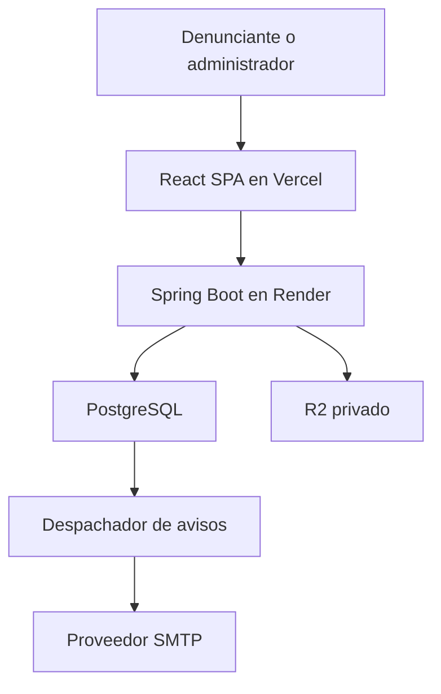
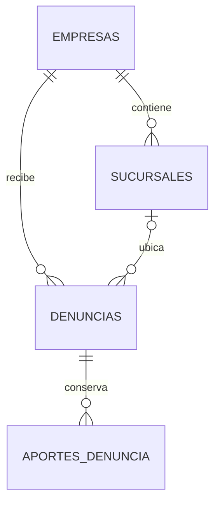
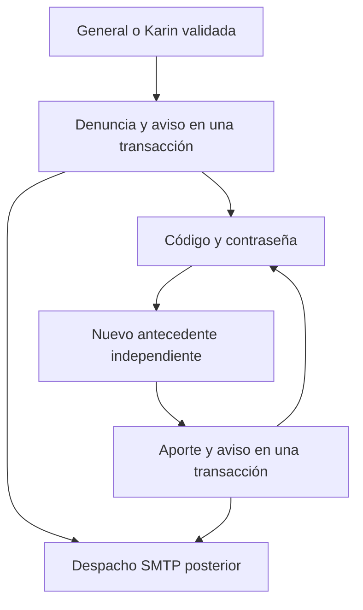

# WEBETIKO — Documentación técnica y transferencia

**Edición:** 24/11/2026. **Estado:** candidata para revisión; no desplegada. Fuente funcional: `WEBETIKO_OBSERVACIONES_23112026.pptx`, 20 láminas, y requisitos anteriores conservados. Las referencias de versiones y pruebas corresponden a esta candidata, no a una certificación de producción.

## 1. Objetivo y alcance

WEBETIKO permite recibir denuncias General y Ley Karin por empresa y sucursal, consultar su estado mediante código y contraseña, aportar antecedentes y administrar su investigación. Mathiesen es un cliente real independiente; `emp-01` y `emp-02` son ejemplos. La plataforma conserva el branding del cliente y el de WEBETIKO.

La entrega cubre software y documentación. No sustituye la aprobación legal, las obligaciones de investigación, los procedimientos de retención de datos ni los acuerdos de propiedad intelectual. Sucursales y una eventual migración de alojamiento son ampliaciones separadas de las correcciones originales. No se cambian precios, saldos ni contratos.

## 2. Arquitectura general

La SPA consume JSON y multipart por HTTPS. La API valida solicitudes, consentimiento, credenciales y pertenencia de los archivos. JPA persiste las entidades. R2 guarda bytes; PostgreSQL guarda referencias privadas. La cola de notificaciones vive en PostgreSQL y se confirma junto con la operación del denunciante.

## 3. Stack y versiones

| Componente | Versión o comprobación |
| --- | --- |
| Java objetivo | 17 en `pom.xml` y Dockerfile |
| Spring Boot | 3.5.11 |
| Maven utilizado | 3.9.12 |
| Spring Security / JPA / Hibernate | Dependencias gestionadas por el BOM de Spring Boot; no se sobrescriben arbitrariamente |
| OpenAPI Springdoc | 2.8.16 |
| AWS SDK S3 | 2.46.8 |
| React / React DOM | 18.3.1 |
| React Router candidato | 7.18.7 |
| Vite candidato | 6.4.6 |
| TypeScript | 5.9.3 |
| Tailwind | 4.1.12 |
| Playwright de pruebas | 1.65.1 |
| Node y npm utilizados | 24.12.0 / 11.13.0 |
| H2 de pruebas | 2.3.232, en memoria |
| PostgreSQL productivo | Motor confirmado por configuración y trabajo previo con Aiven; versión y parámetros actuales del servicio no consultados en esta revisión |

`package-lock.json` es la fuente de resolución exacta del frontend. `pom.xml`, el BOM y la salida de Maven definen el backend. No confundir la versión H2 del ensayo con PostgreSQL productivo.

## 4. Repositorios y carpetas

Frontend: `aleberrot/canalEticov6`, rama principal `main`. Backend: `aleberrot/canal_etico`, rama principal `master`. Candidata en ambos: `fix-observaciones-20261123`. Los commits y PR de entrega se registran en el reporte de cambios.

| Ruta | Responsabilidad |
| --- | --- |
| Frontend `src/app/routes.ts` | Rutas de SPA y regreso del dominio raíz al canal configurado |
| `src/app/layouts/PublicChannelLayout.tsx` | Carga de empresa, cancelación y estado vacío de cada formulario |
| `src/app/pages/` | Portada, denuncias, consulta, estado, acceso y panel |
| `src/app/components/` | Branding, términos, CAPTCHA, sucursales e historial |
| `src/app/services/api.ts` | Contratos, transporte, errores y descargas |
| `businessTime.ts` / `navigation.ts` | Zona de negocio y navegación contextual |
| `src/app/data/` | Términos y catálogo de tipificaciones |
| `public/marca/` / `public/empresas/` | Recursos estáticos de plataforma y clientes |
| `tests/` | Pruebas de contratos, renderizado y navegador |
| Backend `controller/` | Endpoints públicos y administrativos |
| `dto/` | Contratos explícitos, sin serializar entidades JPA completas |
| `service/` | Reglas de negocio, almacenamiento, fechas y avisos |
| `model/` / `repository/` | Entidades y consultas JPA |
| `infra/security/` / `infra/storage/` | Seguridad, CORS y cliente S3 |
| `infra/NotificationScheduler.java` | Activación optativa del envío periódico |
| `src/main/resources/` | Configuración por entorno, sin credenciales embebidas |
| `docs/sql/` / `operations/` | Migraciones revisables y aditivas |

## 5. Funcionamiento del frontend

La portada del canal carga la empresa y muestra General, Ley Karin y consulta. El encabezado principal solicitado es `WEBETICO`; el subtítulo es `Canal de Denuncias`. La marca comercial y su imagen mantienen `WEBETIKO` con K. El componente `WebetikoBrand` usa el recurso recuperado de la PPT; `ClientLogo` conserva el logo de Mathiesen u otro cliente.

`Inicio` dirige a `/canal/{codigo}`. Consulta y acceso administrativo reciben `?empresa={codigo}`; el estado autenticado utiliza además la empresa devuelta por el servidor. La selección de empresa nunca se deriva del código de denuncia ni de una contraseña. Las rutas rechazan destinos externos o códigos malformados. El canal por defecto es Mathiesen, configurable con `VITE_DEFAULT_EMPRESA_CODE`.

La carga pública tiene cancelación al cambiar de canal, una espera acotada y reintento manual. No se reintentan automáticamente los POST de creación o aportes: una respuesta perdida no prueba que el servidor no haya guardado la solicitud. Los formularios nuevos limpian identidad, teléfono, clave, sucursal y archivo; los aportes limpian texto y archivo tras confirmar éxito.

## 6. Funcionamiento del backend y API

`DenunciaService` coordina validación, persistencia, consulta y actualización. Los controladores devuelven DTO y no exponen hashes o claves de objetos R2. La contraseña del denunciante se compara con BCrypt.

| Método y endpoint | Uso y acceso |
| --- | --- |
| `GET /api/empresas/{codigo}` | Identidad pública de empresa activa |
| `GET /api/empresas/{codigo}/sucursales` | Catálogo público activo de esa empresa |
| `POST /api/denuncias` | Crear; multipart con parte `data` JSON y `archivo` opcional |
| `POST /api/denuncias/seguimiento` | JSON `code` y `password`; consulta autenticada por denuncia |
| `POST /api/denuncias/{codigo}/informacion-adicional` | Multipart `password`, `informacion` y/o `archivo`; General y Karin |
| `POST /api/denuncias/{codigo}/aportes/{id}/archivo` | Contraseña en cuerpo; nunca en URL |
| `GET /api/admin/empresas` | Empresas; requiere ADMIN |
| `GET /api/admin/empresas/{codigo}/denuncias` | Reportes filtrados en servidor |
| `GET /api/admin/empresas/{codigo}/estadisticas` | Conteos por empresa |
| `GET/POST/PUT /api/admin/empresas/{codigo}/sucursales...` | Catálogo administrativo, alta, edición y activación |
| `GET /api/admin/denuncias` y `/{codigo}` | Consulta global/detalle de ADMIN |
| `PATCH /api/admin/denuncias/{codigo}/estado` | Estado de investigación |
| `PATCH /api/admin/denuncias/{codigo}/detalle` | Descargo, conclusiones y otros campos administrativos |
| `GET /api/admin/denuncias/{codigo}/archivo` | Archivo inicial protegido |
| `GET /api/admin/denuncias/{codigo}/aportes/{id}/archivo` | Adjunto de aporte protegido |

Las rutas de empresa y sucursal administrativas se definen con detalle en `EmpresaController` y `SucursalController`. `Swagger` documenta contratos existentes; su exposición pública debe revisarse en la política de producción. No existe un endpoint público para ver contraseñas, leer la cola o descargar libremente objetos R2.

## 7. PostgreSQL y relaciones

| Entidad | Datos y restricciones principales |
| --- | --- |
| `empresas` | UUID, código único, nombre, logo/banner, correo legado, activa y auditoría |
| `sucursales` | UUID, empresa obligatoria, código y nombre, activa; unicidad empresa/código |
| `denuncias` | UUID, código público único, tipo, relación, descripción, identificación según tipo, BCrypt, estado, archivos, sucursal e instantánea de su nombre, consentimiento, campos de investigación |
| `aportes_denuncia` | UUID, denuncia, texto y/o clave privada, nombre de descarga e `Instant` de creación; registros independientes |
| `notificaciones_denuncia` | UUID, evento único, empresa/sucursal/código/tipo, clase de aviso, instante, estado, intentos y próximo intento; sin contenido sensible |

La cola identifica cada evento por `NUEVA:{uuidDenuncia}` o `APORTE:{uuidAporte}`. No se copia en ella el cuerpo de la denuncia, identidades, hash o contraseña. No es un duplicado de la investigación ni una cola de archivos.

La migración anterior `docs/sql/20261122_sucursales.sql` documenta el catálogo y la integridad entre empresa y sucursal. La nueva `operations/20261124_observaciones.sql` añade `registered_at`, `last_activity_at` y la cola. No convierte `created_at`/`updated_at` ni actualiza filas históricas. Aplicarla una vez sobre el esquema existente, dentro de una transacción y después de backup. Para una instalación nueva, preparar primero el esquema base en un PostgreSQL aislado y revisar ambas migraciones; el perfil productivo utiliza `ddl-auto=validate`.

## 8. Multiempresa y sucursales

La API pública solo devuelve información de empresa y sucursales activas. El servidor rechaza una ubicación de otra empresa, inexistente o inactiva. Mathiesen exige ubicación; empresas sin catálogo conservan el formulario compatible. El nombre de sucursal se copia a la denuncia para mantener la ubicación histórica aun si después se renombra o desactiva el catálogo.

Las 17 sucursales se conservan en `docs/mathiesen-sucursales.json`. No se inventaron nuevas sucursales para esta PPT. Los ejemplos no heredan el logo ni el catálogo de Mathiesen. El ADMIN actual es global: filtrar por empresa no crea cuentas independientes por cliente.

## 9. Flujo General

1. Abrir el canal de la empresa y elegir denuncia General.
2. Leer términos; la continuación permanece deshabilitada hasta aceptar.
3. Seleccionar ubicación, relación y tipificación; describir hechos. La identificación personal es opcional.
4. Crear contraseña de seguimiento, declarar veracidad, completar verificación local y adjuntar respaldo opcional.
5. La API valida consentimiento/versionado, empresa, ubicación, tamaño y campos. Genera código independiente y BCrypt, guarda la denuncia y el aviso dentro de una transacción.
6. La respuesta permite conservar el código. La contraseña no se devuelve ni se manda por correo. El usuario consulta con ambos datos.

## 10. Flujo Ley Karin

Reutiliza la misma arquitectura y añade identificación, correo y teléfono obligatorios y las tipificaciones específicas de Karin. Esta candidata habilita antecedentes sucesivos tanto en la interfaz como en el servicio. No se relajaron los requisitos de creación ni se transformó Karin en una denuncia anónima.

## 11. Seguimiento y autenticación

La consulta pública requiere código y contraseña válidos; las credenciales viajan por POST y HTTPS. El DTO de seguimiento permite ver estado, ubicación, antecedentes y conclusiones. El descargo reservado no se publica al denunciante. El frontend no guarda la contraseña en almacenamiento persistente; el estado de navegación puede perderse al abrir una URL directa y obliga a volver a consulta.

La administración usa HTTP Basic y la cuenta `admin` definida con `ADMIN_PASSWORD`, codificada con BCrypt en memoria al arrancar. La interfaz existente conserva la credencial Basic codificada en `localStorage`: es una limitación de seguridad pendiente, no cifrado. Salir la elimina. No se entrega una contraseña productiva en este documento.

## 12. Trazabilidad de aportes

Cada POST válido crea un `AporteDenuncia` nuevo. Acepta texto, documento o ambos, sin un límite fijo de cantidad. La consulta ordena por instante e ID y conserva los registros anteriores, incluyendo el registro legado si existía. No se reusa la clave de almacenamiento de un aporte anterior.

Un archivo solo se obtiene verificando primero la denuncia y, en el acceso público, su contraseña. El repositorio busca el aporte por ID **y** denuncia; conocer un ID ajeno no habilita su descarga. El historial aparece también en el panel. La interfaz muestra horas en `America/Santiago`, independientemente de la zona del dispositivo.

## 13. Almacenamiento de documentos

`FileStorageService` selecciona `LocalFileStorageService` o `R2FileStorageService`. R2 usa un cliente S3 compatible, endpoint configurado y región `auto`. `StorageKeyGenerator` genera nombres únicos y seguros por empresa/denuncia. El cliente no recibe las claves de acceso al bucket ni enlaces públicos a los objetos.

Las descargas responden como `application/octet-stream`, `Content-Disposition: attachment`, `Cache-Control: no-store` y `X-Content-Type-Options: nosniff`. El límite es 50 MiB por archivo y 55 MiB por petición multipart. La validación actual no incluye antivirus ni inspección exhaustiva del contenido. Tampoco esta revisión certifica que la opción pública de R2 esté desactivada en la cuenta real: eso exige una verificación de consola autorizada.

El almacenamiento local es para desarrollo; el disco efímero de un contenedor no es un respaldo. No eliminar objetos al hacer rollback de código. Investigar por separado los objetos huérfanos si falla una transacción después de una subida: DB y R2 no comparten una transacción distribuida.

## 14. Correos y cola persistente

Los destinatarios se definen una sola vez mediante `NOTIFICATION_RECIPIENTS`, CSV sin duplicados, con los tres correos aprobados en la plantilla de configuración. `correo_notificacion` de la empresa se conserva por compatibilidad y no se duplica en controladores. Los avisos de esta entrega usan la configuración central.

| Evento | Asunto exacto |
| --- | --- |
| Creación General | Detalle de la Denuncia General |
| Creación Karin | Detalle de la Denuncia Karin |
| Aporte General | Nuevos antecedentes agregados a una Denuncia General |
| Aporte Karin | Nuevos antecedentes agregados a una Denuncia Karin |

Se envía `multipart/alternative`, HTML con tabla de metadatos y texto plano. Incluye empresa, sucursal, código, tipo, instante de evento y acceso HTTPS al panel. No incluye descripción, tipificación de hechos, identidad, contraseña, archivos ni URL pública R2. El HTML escapa los textos variables. `NOTIFICATION_FROM` configura el remitente; por defecto se usa el usuario SMTP cuando es un buzón válido. Sin remitente válido el aviso permanece pendiente; no se utiliza la identidad de la máquina.

El scheduler procesa como máximo diez avisos pendientes por ciclo, cada 30 segundos por defecto. Hay bloqueo pesimista al consultar, clave única por evento y estados `PENDIENTE`, `ENVIADA`, `FALLIDA`. Los fallos reintentan tras 60, 120, 240 y 480 segundos; el quinto fallo queda para revisión. Sin proveedor o destinatarios disponibles los avisos permanecen pendientes. Los logs guardan ID de evento e intento, sin excepciones SMTP que puedan contener secretos.

Un fallo SMTP no vuelve a crear denuncias ni aportes. El `Message-ID` estable por evento ayuda a correlacionar. SMTP no ofrece exactamente una entrega: si el proveedor acepta y después cae el proceso antes del commit, o acepta parcialmente destinatarios, un reintento puede repetir un mensaje. Revisar el proveedor antes de reactivar un evento `FALLIDA`; no borrar ni reiniciar masivamente estados. No se generaron avisos retroactivos para todas las denuncias históricas.

## 15. Panel administrativo

Permite seleccionar empresa, consultar estadísticas y denuncias, abrir detalle, cambiar estado, registrar descargo/conclusiones y administrar sucursales. Las conclusiones son visibles en seguimiento; el descargo permanece reservado. La tabla se desplaza dentro de su contenedor en móvil. La descarga sin respaldo está deshabilitada. Los diálogos incluyen foco inicial, confinamiento de foco, Escape y devolución al control de origen.

El panel no es un sistema de roles por cliente. No dar la cuenta global a un cliente que deba ver solo su propia empresa. Esa ampliación requiere diseño y aprobación específicos.

## 16. Seguridad y datos

Se conservan BCrypt, DTO de consulta, verificación de propiedad de aportes, descargas privadas y límites de archivos. CORS permite un origen exacto mediante `FRONTEND_ORIGIN`; no usar `*` con credenciales. CORS no sustituye autenticación. Las rutas administrativas requieren ADMIN.

Se retiraron credenciales de desarrollo embebidas y se desactivó el SQL detallado por defecto. Las claves que estuvieron versionadas requieren rotación; borrar su literal de una rama no limpia historial ni copias antiguas. No incluir `.env` productivo, ZIP históricos del proyecto, dumps, logs con denuncias o claves en una transferencia.

Pendientes conocidos: CAPTCHA solo cliente, limitación de intentos en servidor, sesión administrativa persistente, separación de cuentas por cliente si se contrata y control de contenido malicioso de archivos. No se hizo un pentest contra producción. La actualización de dependencias se acompaña de auditoría npm y regresión, no de una declaración de seguridad absoluta.

## 17. Infraestructura y despliegue

El 24/11 se verificó por HTTP que el dominio sirve HTML mediante Vercel y que su bundle apunta a `https://canal-etico-api-w9dm.onrender.com`. Los catálogos públicos de emp-01, emp-02 y Mathiesen respondieron, incluyendo 17 sucursales. GitHub informa publicación Vercel completada del `main` de referencia. El despliegue Render `2c3f3ce` fue observado el 23/11; el SHA del proceso activo no puede inferirse solo del JSON público y no se renovó esa lectura de dashboard en esta sesión.

PostgreSQL en Aiven y R2/SMTP corresponden a la instalación previamente verificada y a los adaptadores del código. No se presupone que parámetros, plan o credenciales sigan idénticos: confirmar antes de activar. No hay evidencia de que Oracle Cloud siga ejecutando esta versión. No se modificaron planes, infraestructura ni bases productivas durante esta entrega.

El frontend es estático; el backend se construye con Docker multi-stage Maven/Temurin 17 y ejecuta el JAR sin usuario root. Aplicar migración antes del backend, después publicar frontend. Mantener el scheduler desactivado hasta validar destinatarios, remitente y proveedor. Solo realizar un envío controlado real con autorización específica.

## 18. Variables de entorno

| Variable | Finalidad y condición |
| --- | --- |
| `VITE_CANAL_API_URL` | URL pública de API; compilación frontend |
| `VITE_API_URL` | Alias anterior de API |
| `VITE_DEFAULT_EMPRESA_CODE` | Canal inicial; Mathiesen si no se define |
| `VITE_WEBETIKO_LOGO_URL` | Override opcional confiable; recurso local como alternativa |
| `SPRING_PROFILES_ACTIVE` | `dev`, `prod` o `test` |
| `PORT` | Puerto de backend; Render lo proporciona |
| `DATABASE_URL` | URL **JDBC** de PostgreSQL, con TLS según proveedor |
| `PGUSER`, `PGPASSWORD` | Usuario y secreto de base; nunca versionarlos |
| `ADMIN_PASSWORD` | Contraseña administrativa, obligatoria y no vacía |
| `FRONTEND_ORIGIN` | Origen HTTPS permitido, sin path ni barra sobrante |
| `STORAGE_TYPE` | `local` en desarrollo, `r2` en la instalación con almacenamiento externo |
| `R2_ENDPOINT`, `R2_BUCKET` | Destino S3 compatible y bucket privado |
| `R2_ACCESS_KEY_ID`, `R2_SECRET_ACCESS_KEY` | Credenciales de mínimo privilegio |
| `R2_ACCOUNT_ID` | Identificador compatible con configuración existente |
| `SMTP_HOST`, `SMTP_PORT` | Servidor y puerto; STARTTLS 587 por defecto |
| `SMTP_USERNAME`, `SMTP_PASSWORD` | Credenciales SMTP |
| `MAIL_HOST`, `MAIL_PORT`, `MAIL_USERNAME`, `MAIL_PASSWORD` | Alias compatibles si no se define su equivalente `SMTP_*` |
| `NOTIFICATION_FROM` | Remitente autorizado por el proveedor |
| `NOTIFICATION_RECIPIENTS` | Tres destinatarios aprobados, CSV; vacía conserva eventos pendientes |
| `NOTIFICATION_ADMIN_URL` | URL HTTPS sin credenciales ni parámetros |
| `NOTIFICATIONS_ENABLED` | Despachador periódico; `false` en pruebas/activación inicial |
| `NOTIFICATIONS_POLL_MS` | Intervalo de consulta de cola |
| `APP_CLIENTS_MATHIESEN_ENABLED` | Seed PostgreSQL del cliente; desactivar en H2 |
| `MATHIESEN_NOTIFICATION_EMAIL` | Correo legado del seed; no altera el destino central de avisos |

El seed no exige correo para un cliente ya existente ni sobrescribe su configuración. Para dar de alta un cliente nuevo sí requiere un destinatario de inicialización.

La configuración TLS particular de un proveedor, el almacenamiento de secretos y las políticas de respaldo se verifican en el servicio real. `.env.example` contiene nombres y campos vacíos; Spring Boot requiere exportar las variables, no carga `.env` automáticamente. Las variables Vite son públicas y solo deben contener configuración pública.

## 19. Instalación local

Clonar ambas PR o hacer checkout de sus commits. Instalar Java 17, Node 24+ y PostgreSQL para un desarrollo persistente. Crear una base de desarrollo vacía y un usuario dedicado. Configurar el entorno tomando las plantillas, con correo desactivado y almacenamiento local. Ejecutar `mvnw spring-boot:run` y luego `npm ci`, configurar `.env.local` y `npm run dev` en el frontend. Acceder por `localhost:5173` y mantener `FRONTEND_ORIGIN` coincidente.

Para repetir QA sin PostgreSQL usar el arnés de README: H2 en memoria, correo/almacenamiento simulados, backend 18081 y frontend 5173. Nunca sustituir la URL H2 por Aiven para ejecutar esa suite. El final del arnés descarta sus registros.

## 20. Compilación y pruebas

Frontend: `npm run check`, `npm test`, `npm run build`. Navegador: iniciar arnés y Vite locales, `npx playwright install chromium` o `CHROME_EXECUTABLE`, y `npm run test:browser`. Backend: `mvnw test` y `mvnw package`. El wrapper Windows es `mvnw.cmd`. La configuración de Byte Buddy para equipos que impiden autoattach se explica en README.

Los tests ejercitan fechas cercanas a medianoche, invierno/verano, datos legados, cuatro asuntos, MIME alternativo, destinatarios, fallos SMTP, reintentos, aportes General/Karin, propiedad de descargas, multiempresa y consentimiento. El ensayo Chrome utiliza la zona UTC del dispositivo para demostrar que Chile no depende del navegador. Las cifras efectivas y evidencias están en el reporte. No se ejecutaron Safari/iOS reales ni servicios externos con datos personales.

## 21. Operación, monitoreo y respaldos

Supervisar disponibilidad de API, latencia por endpoint, errores 4xx/5xx y la antigüedad de `PENDIENTE`/`FALLIDA`. Una cola que no baja puede indicar scheduler desactivado, configuración incompleta o SMTP fallido. Consultar solo conteos y estados para operación cotidiana; el código de denuncia es información de acceso y no debe difundirse en logs generales.

Definir respaldo cifrado PostgreSQL con retención, acceso limitado y restauración ensayada. Respaldar objetos R2 por un procedimiento separado y conservar coherencia con las claves de DB. Confirmar con Aiven las funciones de backup efectivamente contratadas; no asumir PITR disponible por el nombre del proveedor. Guardar configuración sin secretos en Git y secretos en el gestor de cada servicio.

Tras un incidente, conservar evidencia mínima y limitar acceso. No enviar registros completos por correo. Renovar credenciales expuestas y revisar accesos antes de habilitar operación normal.

## 22. Solución de problemas

| Síntoma | Comprobación y acción |
| --- | --- |
| Canal tarda en abrir | Distinguir HTML Vercel, API activa y arranque frío; revisar estado Render y red. No reintentar POST |
| Selector pide autenticación o no carga | Confirmar backend con ruta pública, CORS y catálogo activo; no poner Basic de administrador en el selector |
| 17 sucursales ausentes | Revisar empresa Mathiesen y migración/catálogo; no rellenar con datos ficticios |
| Fecha un día adelantada | Revisar `createdAtInstant` o consentimiento histórico y formateador Santiago; nunca restar un día al dato |
| No llegan correos | Revisar destinatarios, remitente, host/TLS, scheduler y estados de cola; verificar resultado en proveedor antes de reintentar |
| 401 de seguimiento | Reingresar código/clave; no cambiar la contraseña ni revelar existencia de la denuncia |
| Archivo 404 | Verificar ID/pertenencia y objeto privado; no publicar el bucket para resolverlo |
| 413 | Archivo mayor de 50 MiB o límite del proxy; revisar también tamaño total multipart |
| ADMIN no entra | Verificar `ADMIN_PASSWORD`, origen y credencial local; no publicar secretos en diagnósticos |
| Backend falla al iniciar | Revisar configuración y esquema validado; aplicar migración aprobada antes de arrancar |

## 23. Actualización y recuperación

Mantener staging separado. Revisar diferencias, correr tests, respaldar DB/objetos y solicitar confirmación de publicación de commits concretos. Aplicar SQL revisado, iniciar backend con cola desactivada, comprobar catálogos y rutas, publicar frontend y ejecutar aceptación. Habilitar avisos después de revisar destinos y proveedor.

Para rollback volver a los commits anteriores documentados. Mantener las columnas y tabla nuevas: son aditivas y no perjudican al código anterior. Desactivar el scheduler para evitar avisos no revisados. No borrar denuncias, aportes, claves R2 o cola para volver atrás. Si se requiere restaurar DB, decidir un punto y sus posibles pérdidas junto al responsable; no restaurar automáticamente sobre denuncias nuevas.

## 24. Limitaciones conocidas

No se verificaron parámetros internos actuales JVM/PostgreSQL, entrega SMTP real, permisos reales R2, restauración de backup ni Safari/iOS. Las mediciones HTTP son muestras de esta red, sin descomponer DNS/TLS/consulta SQL ni forzar inactividad Render. El servicio puede conservar limitaciones de arranque frío del plan previo; verificar plan actual antes de cotizar cambios. No existe una garantía SMTP de exactamente una entrega. Los registros antiguos sin instante siguen mostrando únicamente su fecha original.

La seguridad pendiente del apartado 16 impide declarar la plataforma certificada o cerrada sin reservas. Las capturas y datos del ensayo son sintéticos. Las claves antiguas deben rotarse y revisarse también los archivos históricos del repositorio antes de una transferencia contractual.

## 25. Transferencia y evolución

Entregar los dos repositorios en los commits aprobados, documentación, plantillas vacías, lockfiles canónicos, Dockerfile, migraciones, scripts y resultados de pruebas. Excluir `.env` reales, secretos, archivos personales, dumps y ZIP históricos no auditados. Definir quién conserva cuentas, dominios y acceso al proveedor; la entrega de código no implica por sí sola cesión de derechos o credenciales.

Priorizar después de esta validación la protección de intentos públicos, una sesión administrativa más segura, cuentas por cliente si se necesitan, análisis de archivos y una restauración ensayada. Medir carga activa/fría con un protocolo acordado antes de decidir alojamiento. Cada ampliación comercial debe quedar separada de las correcciones del proyecto original.

## Reauditoría de correspondencia

La revisión posterior de las PR corrigió el arranque del cliente existente, el remitente de avisos y el contexto tras expirar la sesión. Consultar `AUDITORIA_PR_CLIENTE_20261124.md`; 49 pruebas Java, 57 frontend y 9 comprobaciones Chrome aprobadas. La publicación y los servicios reales continúan pendientes de validación.
